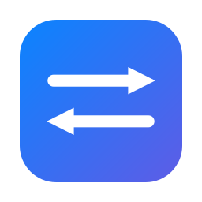
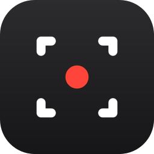

<!-- Generated by tools/lib/catalogue.mjs from apps/*.json and Casks/*.rb. Edit those, not this file. -->
<div align="center">

# SAASEmpiree apps

**Every SAASEmpiree app, installed and updated from one place.**

[](#quick-start)
[](#windows)
[](#catalogue)

</div>

Small, local-first apps for macOS (and Windows for some). The code of each app lives in a private repository; this public repository is the distribution hub: Homebrew casks, Scoop manifests, Sparkle update feeds, and the GitHub Releases that hold every binary.

## Quick start

```sh
brew tap saasempiree/tap
brew install --cask saasempiree/tap/<app>      # e.g. saasempiree/tap/units
```

Upgrade everything installed from this tap with `brew upgrade`. Apps marked **Sparkle** update themselves.

> [!NOTE]
> The apps are signed with a self-signed certificate (stable across updates, so macOS keeps the permissions you grant), but they are not notarized by Apple. If macOS says an app “cannot be opened” the first time, run once:
> `xattr -dr com.apple.quarantine "/Applications/<App>.app"`

### Windows

```powershell
scoop bucket add saasempiree https://github.com/SAASEmpiree/homebrew-tap
scoop install saasempiree/<app>
```

## Catalogue

| App | What it does | Latest |
|---|---|---|
| [Omnia](#omnia) | Convert, compress, merge and clean files 100% on your Mac, with zero network. | 1.0.0 |
| [Classeur](#classeur) | Drop your paperwork in; it gets read, filed by year and month, and encrypted on your Mac. | pending |
| [Pécule](#pecule) | Simulate, track and budget your money on your Mac, with no bank link and no account. | pending |
| [Memora](#memora) | Notes, spaced-repetition flashcards, quizzes and exam planning, organised by subject, all on your Mac. | pending |
| [CodeLearn](#codelearn) | A technical dictionary you actually remember: 349 dev, cloud and AI terms with spaced repetition. | pending |
| [Flow](#flow) | Translate anything from your menu bar: on-device by default, DeepL or any LLM when you want it. | pending |
| [Units](#units) | Convert length, area, mass, temperature, speed, volume and data from your menu bar, fully offline. | 0.1.1 |
| [FrameLine](#frameline) | Screenshots, screen recordings, annotation and OCR from your menu bar, 100% local. | 1.0.0 |
| [AppGrid](#appgrid) | Keeps Finder's Applications windows laid out as a 6-column, iPhone-style icon grid. | pending |
| [Comète](#comete) | Run Claude Code, Codex, Gemini and shells side by side in one cockpit, with VS Code-grade terminals. | pending |
| [Jarvis](#jarvis) | A voice-driven assistant for your Mac, powered by Claude, that talks back in French and acts on your apps. | pending |
| [Zap](#zap) | Open any project in your code editor in under two seconds, from a Spotlight-style menu-bar palette. | 2.5.8 |
| [PleurIA](#pleuria) | A menu-bar planet that cries at every AI request and counts the litres of water your tokens cost. | pending |
| [Kairo](#kairo) | A shared workspace for small teams: issues, docs and projects, Linear meets Notion. | own pipeline |

### Omnia

**Convert, compress, merge and clean files 100% on your Mac, with zero network.**

Omnia gathers the little file chores you would normally hand to a website: convert an image or a document, shrink a PDF, merge or split pages, trim audio and video, strip location and camera data from photos. Everything happens on your computer: no upload, no account, no network.

| | |
|---|---|
| Platform | macOS 10.13+ · Apple Silicon · Windows 10+ |
| Stack | Tauri · Rust |
| Latest | [1.0.0](https://github.com/SAASEmpiree/homebrew-tap/releases/tag/omnia-v1.0.0) |

**Install**

```sh
brew install --cask saasempiree/tap/omnia
```

Windows ([Scoop](https://scoop.sh)):

```powershell
scoop bucket add saasempiree https://github.com/SAASEmpiree/homebrew-tap
scoop install saasempiree/omnia
```

**Updates**: Through Homebrew: `brew upgrade --cask omnia` (or `brew upgrade` for everything).

---

### Classeur

**Drop your paperwork in; it gets read, filed by year and month, and encrypted on your Mac.**

Classeur files your administrative papers (bills, tax notices, IDs, contracts) for you. It reads them (OCR), makes them searchable, and reminds you before a document expires or a deadline comes up. Your documents stay on your computer, encrypted, and the app works offline.

| | |
|---|---|
| Platform | macOS 10.13+ · Apple Silicon |
| Stack | Tauri · Rust |
| Latest | first release pending |

**Install**

```sh
brew install --cask saasempiree/tap/classeur
```

_The cask is published with Classeur's first release from this tap; until then the command above reports “no cask”._

**Updates**: Through Homebrew: `brew upgrade --cask classeur` (or `brew upgrade` for everything).

---

<a name="pecule"></a>
### Pécule

**Simulate, track and budget your money on your Mac, with no bank link and no account.**

Pécule helps you see your money clearly. Simulators project what savings, regular investing or a mortgage would give over time, all drawn on one interactive curve, with portfolio tracking and recurring subscriptions next. Local, private, no account. An educational tool, not investment advice.

| | |
|---|---|
| Platform | macOS 10.13+ · Apple Silicon |
| Stack | Tauri · Rust |
| Latest | first release pending |

**Install**

```sh
brew install --cask saasempiree/tap/pecule
```

_The cask is published with Pécule's first release from this tap; until then the command above reports “no cask”._

**Updates**: Through Homebrew: `brew upgrade --cask pecule` (or `brew upgrade` for everything).

---

### Memora

**Notes, spaced-repetition flashcards, quizzes and exam planning, organised by subject, all on your Mac.**

Memora brings all your revision together, organised by subject: course notes, flashcards scheduled by spaced repetition (FSRS), quizzes and mock exams, an exam planner and a focus timer. A passage of your notes becomes a card or a question in one click. Offline, no account, no ads, no tracking.

| | |
|---|---|
| Platform | macOS 10.13+ · Apple Silicon |
| Stack | Tauri · Rust |
| Latest | first release pending |

**Install**

```sh
brew install --cask saasempiree/tap/memora
```

_The cask is published with Memora's first release from this tap; until then the command above reports “no cask”._

**Updates**: Through Homebrew: `brew upgrade --cask memora` (or `brew upgrade` for everything).

---

### CodeLearn

**A technical dictionary you actually remember: 349 dev, cloud and AI terms with spaced repetition.**

CodeLearn is a dictionary of technical vocabulary (dev, systems, networking, cloud, security, AI) that you memorise. Every term has a plain definition, an analogy, a code sample, the classic pitfalls and a quiz, and a spaced-repetition engine brings back the terms you are about to forget. No account, no network. The interface is in French.

| | |
|---|---|
| Platform | macOS 14+ (Sonoma) · Apple Silicon |
| Stack | Swift · SwiftUI |
| Latest | first release pending |

**Install**

```sh
brew install --cask saasempiree/tap/codelearn
```

_The cask is published with CodeLearn's first release from this tap; until then the command above reports “no cask”._

**Updates**: Through Homebrew: `brew upgrade --cask codelearn` (or `brew upgrade` for everything).

---

### Flow

**Translate anything from your menu bar: on-device by default, DeepL or any LLM when you want it.**

Flow is a small translator that lives in your menu bar. Type or paste text and the translation appears as you type, on your Mac with Apple's built-in engine. When you want more polish, switch to DeepL or any OpenAI-compatible model, local Ollama included. 115 languages, interface in 20.

| | |
|---|---|
| Platform | macOS 15+ (Sequoia) · Apple Silicon & Intel |
| Stack | Swift · SwiftUI |
| Latest | first release pending |

**Install**

```sh
brew install --cask saasempiree/tap/flow
```

_The cask is published with Flow's first release from this tap; until then the command above reports “no cask”._

**Updates**: Updates itself in the background with [Sparkle](https://sparkle-project.org): it checks once a day against the signed feed [`appcasts/flow.xml`](appcasts/flow.xml). Homebrew leaves it alone (`auto_updates true`).

---

<a name="units"></a>
###  Units

**Convert length, area, mass, temperature, speed, volume and data from your menu bar, fully offline.**

Units converts length, mass, temperature, speed, volume and data sizes one click away. Click the ⇄ icon in the menu bar, pick a category, type a number: done. Fully offline, no account, no tracking.

| | |
|---|---|
| Platform | macOS 13+ (Ventura) · Apple Silicon |
| Stack | Swift · SwiftUI |
| Latest | [0.1.1](https://github.com/SAASEmpiree/homebrew-tap/releases/tag/units-v0.1.1) |

**Install**

```sh
brew install --cask saasempiree/tap/units
```

**Updates**: Updates itself in the background with [Sparkle](https://sparkle-project.org): it checks once a day against the signed feed [`appcasts/units.xml`](appcasts/units.xml). Homebrew leaves it alone (`auto_updates true`).

---

<a name="frameline"></a>
###  FrameLine

**Screenshots, screen recordings, annotation and OCR from your menu bar, 100% local.**

FrameLine captures an area, a window or the whole screen, and records your screen with system audio and microphone. Annotate a shot, pin it on screen, copy its text (OCR), trim a recording, and find everything again in the history. 100% local, interface in 10 languages.

| | |
|---|---|
| Platform | macOS 14+ (Sonoma) · Apple Silicon |
| Stack | Swift · SwiftUI |
| Latest | [1.0.0](https://github.com/SAASEmpiree/homebrew-tap/releases/tag/frameline-v1.0.0) |

**Install**

```sh
brew install --cask saasempiree/tap/frameline
```

**Updates**: Through Homebrew: `brew upgrade --cask frameline` (or `brew upgrade` for everything).

---

### AppGrid

**Keeps Finder's Applications windows laid out as a 6-column, iPhone-style icon grid.**

AppGrid is an invisible helper that keeps Finder's Applications windows laid out like an iPhone home screen: a 6-column grid where an icon dropped on a slot takes it and the others shift. It steps aside as soon as you sort the window another way. No interface, no settings, nothing stored.

| | |
|---|---|
| Platform | macOS 26+ (Tahoe) · Apple Silicon |
| Stack | Swift · SwiftUI |
| Latest | first release pending |

**Install**

```sh
brew install --cask saasempiree/tap/appgrid
```

_The cask is published with AppGrid's first release from this tap; until then the command above reports “no cask”._

**Updates**: Through Homebrew: `brew upgrade --cask appgrid` (or `brew upgrade` for everything).

---

<a name="comete"></a>
### Comète

**Run Claude Code, Codex, Gemini and shells side by side in one cockpit, with VS Code-grade terminals.**

Comète runs your AI coding agents (Claude Code, Codex, Gemini or a plain shell) side by side, each in a real terminal, and shows at a glance which one is working, waiting or done. Task titles, notifications, skills and dictation are built in. The interface is in French.

| | |
|---|---|
| Platform | macOS 11+ · Apple Silicon |
| Stack | Tauri · Rust |
| Latest | first release pending |

**Install**

```sh
brew install --cask saasempiree/tap/comete
```

_The cask is published with Comète's first release from this tap; until then the command above reports “no cask”._

**Updates**: Through Homebrew: `brew upgrade --cask comete` (or `brew upgrade` for everything).

---

### Jarvis

**A voice-driven assistant for your Mac, powered by Claude, that talks back in French and acts on your apps.**

Jarvis is a voice assistant that lives in your menu bar as a glowing orb. Speak to it and it answers out loud in French, powered by Claude, and acts on your Mac: files, apps, windows, the web. It remembers what you told it and what it already did.

| | |
|---|---|
| Platform | macOS 14+ (Sonoma) · Apple Silicon |
| Stack | Swift · SwiftUI |
| Latest | first release pending |

**Install**

```sh
brew install --cask saasempiree/tap/jarvis
```

_The cask is published with Jarvis's first release from this tap; until then the command above reports “no cask”._

**Updates**: Through Homebrew: `brew upgrade --cask jarvis` (or `brew upgrade` for everything).

---

<a name="zap"></a>
###  Zap

**Open any project in your code editor in under two seconds, from a Spotlight-style menu-bar palette.**

Press ⌥ Space, type two or three letters, hit Return: Zap finds the project among the folders you told it to watch and opens it in a new window of your editor. Fuzzy search learns what you open most. 100% local, interface in 20 languages.

| | |
|---|---|
| Platform | macOS 14+ (Sonoma) · Apple Silicon |
| Stack | Swift · SwiftUI |
| Latest | [2.5.8](https://github.com/SAASEmpiree/homebrew-tap/releases/tag/zap-v2.5.8) |

**Install**

```sh
brew install --cask saasempiree/tap/zap
```

**Updates**: Through Homebrew: `brew upgrade --cask zap` (or `brew upgrade` for everything).

---

### PleurIA

**A menu-bar planet that cries at every AI request and counts the litres of water your tokens cost.**

PleurIA puts a small Earth in your menu bar that sheds a tear every time an AI agent receives a request, and keeps a running count of the litres of water your prompts cost the data centres. A playful, slightly guilt-inducing gauge. Everything is computed locally; nothing is sent anywhere.

| | |
|---|---|
| Platform | macOS 13+ (Ventura) · Apple Silicon |
| Stack | Swift · SwiftUI |
| Latest | first release pending |

**Install**

```sh
brew install --cask saasempiree/tap/pleuria
```

_The cask is published with PleurIA's first release from this tap; until then the command above reports “no cask”._

**Updates**: Through Homebrew: `brew upgrade --cask pleuria` (or `brew upgrade` for everything).

---

### Kairo

**A shared workspace for small teams: issues, docs and projects, Linear meets Notion.**

Kairo is a desktop workspace for a small team: issues and projects in the spirit of Linear, documents in the spirit of Notion, updated live for everyone. It ships through its own release pipeline, not through this tap.

| | |
|---|---|
| Platform | macOS 12+ (Monterey) · Apple Silicon · Windows 10+ |
| Stack | Electron |

**Install**

Kairo is not distributed through Homebrew. See its site: https://saasempiree.github.io/kairo-site/

**Updates**: Kairo updates itself through its own release pipeline.

---

## How this tap works

| Path | What it holds |
|---|---|
| `Casks/<app>.rb` | Homebrew casks, generated at each release (version + sha256). |
| `bucket/<app>.json` | Scoop manifests for the Windows builds. |
| `appcasts/<app>.xml` | Sparkle feeds (EdDSA-signed items), served from `https://raw.githubusercontent.com/SAASEmpiree/homebrew-tap/main/appcasts/<app>.xml`. |
| `apps/<app>.json` | Catalogue data this README is generated from. |
| `icons/<app>.png` | App icons used above. |
| [Releases](https://github.com/SAASEmpiree/homebrew-tap/releases) | One release per app version, tagged `<app>-v<version>`, holding the zipped `.app`. |
| `tools/` | `ship`, `sync-after-install` and `audit`, the scripts that publish a release and keep GitHub equal to what is installed. See [tools/README.md](tools/README.md). |

Releases are cut by `tools/ship` (or `tools/sync-after-install` at the end of an app's install script): it tags the app's private repo, uploads the zipped `.app` here, regenerates the cask and, for Sparkle apps, the signed appcast. Nothing in this repository is edited by hand except `apps/*.json` descriptions and `tools/`.

## License

Each app keeps its own license. The tap's scripts and metadata: © SAASEmpiree, all rights reserved.
